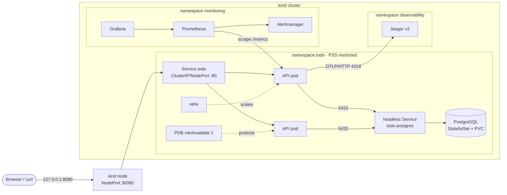
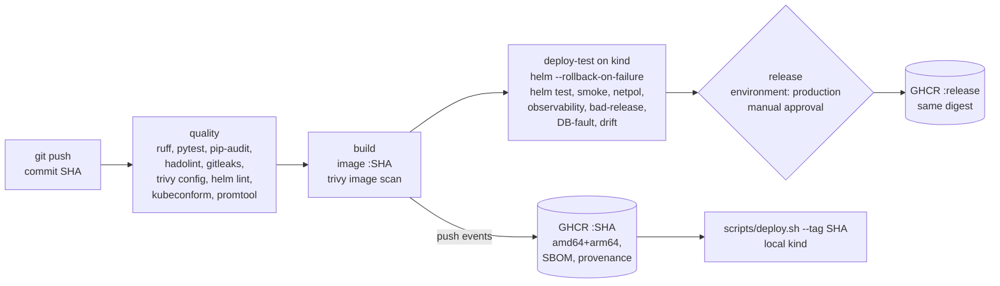

# Architecture

## Components

| Component | Kind | Why this workload type |
|---|---|---|
| API (FastAPI + Uvicorn) | `Deployment`, 2+ replicas, HPA 2-5 | Stateless; any pod can serve any request, so replicas are interchangeable and can roll one at a time. |
| PostgreSQL 17 | `StatefulSet` (1 replica) + `volumeClaimTemplate` | Needs a stable identity and storage that follows the pod across restarts. One replica: no HA (see limitations). |
| Service `todo` | ClusterIP (default), NodePort locally | Single stable entry point; load-balances across *ready* pods only. |
| Service `todo-postgres` | Headless | Governing service of the StatefulSet; gives the DB a stable DNS name. |
| Secret `todo-db-credentials` | created by `scripts/deploy.sh`, outside Helm | Keeps the password out of git, values files and Helm release history. |
| NetworkPolicies | default-deny + 3 allow rules | Only the paths the app needs exist on the network. |

## Request path (user creates a todo)

1. `POST http://127.0.0.1:8080/api/todos` hits the kind node's published port, which maps to NodePort `30080`.
2. kube-proxy forwards to one **ready** endpoint of Service `todo` (pods failing `/readyz` are not endpoints).
3. NetworkPolicy `todo-api` admits TCP 8000. `RequestMiddleware` assigns `x-request-id`, starts the latency timer, and (if tracing is on) the OpenTelemetry span.
4. FastAPI validates the body (Pydantic: 1-200 chars, else `422`), and SQLAlchemy takes a pooled connection (`pool_pre_ping` discards dead ones).
5. The API connects to `todo-postgres:5432`. Egress is allowed only to PostgreSQL, DNS and the tracing collector. PostgreSQL's policy admits only API pods.
6. `INSERT ... COMMIT`, then the response is `201`. The middleware records `http_requests_total{route="/api/todos",status="201"}` and the latency histogram, writes one JSON access-log line (`request_id`, `trace_id`, `duration_ms`) and adds `x-app-version`.

## Commit-to-running path

The SHA is the single identifier throughout: git commit, image tag, OCI label `org.opencontainers.image.revision`, env `GIT_SHA` inside the container, pod label `app.kubernetes.io/version`, `/version` response, `x-app-version` header, and the Prometheus series `todo_app_build_info{git_sha=...}`.

## Failure boundaries

| Failure | What happens | Why |
|---|---|---|
| One API pod crashes or hangs | Liveness fails, kubelet restarts it; Service routes to the other replica; PDB stops voluntary evictions dropping below 1. | Replicas + probes. |
| PostgreSQL down | `/readyz` returns 503, so all API pods leave the Service (fast failure, not timeouts). `/healthz` stays 200, so **no restart storm**. `TodoDatabaseUnreachable` pages. When the DB returns, pods turn ready on their own. Data stays on the PVC. | Liveness and readiness deliberately check different things. Demonstrated by `scripts/fault-demo.sh`. |
| Bad release (crashes, bad image, failing readiness) | New pod never turns ready, so `maxUnavailable: 0` keeps all old pods serving. Helm `--rollback-on-failure` reverts the release after the timeout. | Demonstrated by `scripts/release-demo.sh` (0 failed requests). |
| Node loss (multi-node) | API pods reschedule. Spread constraint prefers different nodes. PostgreSQL has RWO storage tied to a node, so the outage lasts until it reschedules. | Single DB replica is an accepted limitation. |
| Monitoring stack down | App unaffected (scraping is pull-based; OTLP export is async and drops on failure). | Telemetry is not on the request path. |

## Linux, networking and cloud concepts applied

- **Process model:** Uvicorn runs as PID 1 (exec-form `CMD`), so it receives SIGTERM directly. `preStop: sleep 5` lets endpoint removal propagate before shutdown, and `--timeout-graceful-shutdown 20` drains in-flight requests within `terminationGracePeriodSeconds: 30`.
- **Users and filesystem:** fixed UID 10001, no shell, code owned by root (read-only to the app), read-only root filesystem with a size-limited `emptyDir` at `/tmp`, all Linux capabilities dropped, seccomp `RuntimeDefault`.
- **Networking:** NodePort published on `127.0.0.1` only (not on the LAN), cluster DNS service discovery, headless service for stable DB naming, L3/L4 allow-listing with NetworkPolicy (ingress *and* egress).
- **Cloud mapping:** on a managed cluster the same chart would use an Ingress/Gateway with TLS instead of NodePort, a managed database (RDS/Cloud SQL) instead of the StatefulSet (`postgres.enabled=false`, `DB_HOST` pointing at the endpoint), and an external secrets operator instead of `kubectl create secret`.
